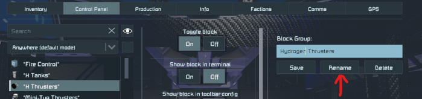
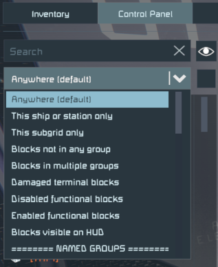
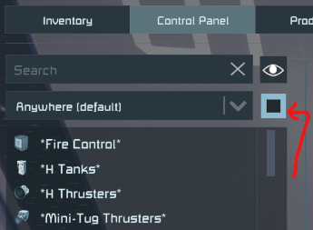
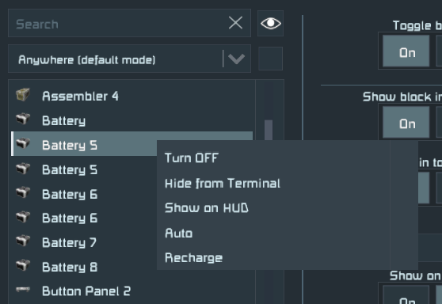
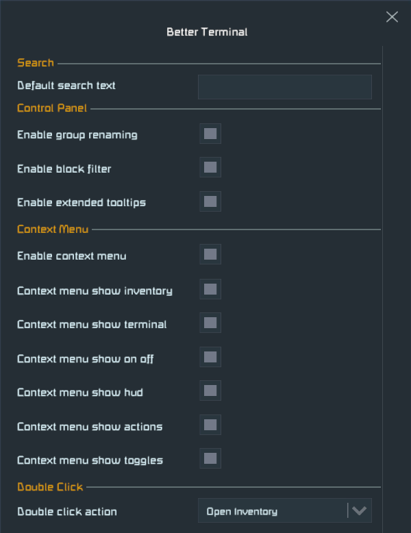

# Better Terminal

Terminal UI improvements for Space Engineers.

For support please [join the SE Mods Discord](https://discord.gg/PYPFPGf3Ca).

Please consider supporting my work on [Patreon](https://www.patreon.com/semods) or one time via [PayPal](https://www.paypal.com/paypalme/vferenczi/).

*Thank you and enjoy!*

## Prerequisites

- [Space Engineers](https://store.steampowered.com/app/244850/Space_Engineers/)
- [Pulsar](https://github.com/SpaceGT/Pulsar)

## Installation

1. Install [Pulsar](https://github.com/StarCpt/Pulsar-Installer/)
2. Run the game
3. In the new **Plugins** menu add the "Better Terminal" plugin
4. Apply and restart the game as requested

## Features

### Control Panel

#### Renaming groups

There is a new **Rename button** under the group name. 

Select the group to rename, edit the name in the group name text box, then click Rename.
Any block toolbars referencing the group will be updated automatically, 
so there will be no broken slots.

#### Block filter

There is a **dropdown list** below the block search field.
You can filter the block list for various **common situations**,
by **block group** and by **block type**. 

The default filter mode is identical to the default SE behavior
except of fixing the bug with initial scroll position of the block list.

_The block filter is reset to default mode each time you open
the Terminal UI to prevent confusion._

#### Default block names

There is a **checkbox** right next to the block filter dropdown.

It **toggles showing the default block names** instead of the player defined custom ones.
This is really useful to find blocks by their type, regardless of how they were renamed.

Enabling this feature will **not** rename your blocks back to their default name.
All it does is changing the list to show the default names until it is enabled.
You can still see the custom block names in the tooltips as you hover over the
blocks in the list.

_The default name checkbox is cleared each time you open the Terminal UI to prevent confusion._

#### Block context menu

**Right-clicking** a block in the Terminal list opens a **context menu** with quick actions
for that block, without having to scroll through its settings panel.

The menu can include (each item can be toggled individually in the configuration):

- **Open Inventory** — switch straight to the inventory screen for this block _(blocks with inventory only)_
- **Turn ON / Turn OFF** — toggle the block on or off _(functional blocks only)_
- **Show in Terminal / Hide from Terminal** — control whether the block appears in the list
- **Show on HUD / Hide from HUD** — toggle the block's HUD marker
- **Enable / Disable Use Conveyor** — toggle conveyor connection _(reactors, refineries, gas generators, etc.)_
- **Block actions** — all relevant terminal actions for the block, sorted alphabetically. Only the actions that make sense for the block's current state are shown (e.g. "Turn On" is hidden when the block is already on).
- **Toggles** — additional on/off properties exposed by the block or its mods.

#### Double-click action

You can configure a **double-click shortcut** that triggers whenever you double-click a block
in the Terminal list. Available actions:

| Setting | What happens |
|---|---|
| None _(default)_ | No action |
| Open Inventory | Opens the inventory screen for that block |
| Toggle ON/OFF | Turns the block on or off |
| Toggle Show on HUD | Toggles the block's HUD marker |
| Toggle Terminal | Shows or hides the block in the Terminal list |

The double-click action is configured in the plugin settings (see [Configuration](#configuration) below).

<!-- TODO: add screenshot of the double-click setting in the config dialog -->

#### Faster list editing with double-click

Several block-specific terminal panels now support **double-clicking items** in their lists as a
shortcut for the most common action, instead of having to click the item and then press a button:

| Block | List | Double-click does |
|---|---|---|
| **Conveyor Sorter** | Available filters | Adds the item to active filters |
| **Conveyor Sorter** | Active filters | Removes the item |
| **Jump Drive** | GPS entries / Beacons | Selects the entry as jump target |
| **Jump Drive** | Selected target | Removes the selected target |
| **Event Controller** | Available blocks | Adds the block to the selection |
| **Event Controller** | Selected blocks | Removes the block |
| **Turret Control Block** | Available tools | Adds the tool to the selection |
| **Turret Control Block** | Selected tools | Removes the tool |

## Ship Organizer

Renames, groups and hides the blocks of a ship by one consistent system and sets up the
toolbars of its main cockpit and remote control.

Right-click any block of the ship in the Terminal and choose **Organize Ship**, or sit in the
ship and enter `/bt organize` into the chat. The ship is the grid with everything attached to
it by rotors, pistons, hinges and wheels. Ships docked on connectors are left alone, and so are
blocks you have no access to.

What it does, in this order:

1. **Saves a backup** of everything it may change.
2. **Renames every block** to its default name. Long default names are shortened, keeping
   the last word, which tells what the block is: `Sci-Fi Large Atmospheric Thruster` becomes
   `Large Atmo Thruster`. Blocks which would share a name are numbered from 1.
3. **Adds suffixes**: cameras, connectors, spotlights and landing gears get the side of the
   ship they face (`Camera Front`, `Connector Back`), the repair projector becomes
   `Projector Repair`, and the main cockpit `Cockpit Main` if there are more cockpits.
   Sides are as seen from the main cockpit: `Front`, `Back`, `Left`, `Right`, `Top`, `Bottom`.
4. **Groups** the blocks used together and **hides them from the block list**: thrusters
   (all, by type and by thrust direction, like `Hydrogen Thrusters (Up)`), gyroscopes,
   batteries, lights, spotlights, drills, welders, grinders, wheels, cameras, landing gears,
   tanks by gas, generators, engines, reactors, solar panels, wind turbines, cargo containers,
   parachutes, turrets, guns, decoys, doors, air vents and jump drives. Two or more
   connectors get a `Connectors` group, but stay visible.
5. **Hides** cockpits, seats and button panels from the block list.
6. **Hides blocks from the inventory screen** if they are not reachable from the ship's
   largest cargo container through conveyors, or if items only pass through them: tools,
   connectors, ejectors, collectors, sorters and gas tanks.
7. **Sets up the main cockpit's toolbar**. Pages 1 and 2 are always rewritten, the other
   pages below only if the ship has something for them. All other pages stay as they are.

   | Page | Purpose | Slots |
   |---|---|---|
   | 1 | Flight and operation | Tools ON/OFF, lift thruster override down and up, front, back and bottom camera; 7: lights, 8: spotlights, 9: lock the connector (or the landing gears) |
   | 2 | Parked | 1: connector lock, 2: landing gear lock, 3: battery recharge, 4: hydrogen tank stockpile, 5: oxygen tank stockpile, 6: thrusters, 7: gyroscopes, 8: hydrogen engines, 9: reactors |
   | 3 | Jump | Jump, recharge, ON/OFF, jump distance down and up |
   | 4 | Cameras | View of each camera |
   | 5 | Systems | ON/OFF of each thruster type, wheels, O2/H2 generators, turrets, guns, decoys, solar panels, wind turbines |
   | 9 | Repair | 1: welders, 8: take control of the remote control, 9: repair projector ON/OFF |

8. **Copies the cockpit's toolbar to the remote control** as it is, then adds the cockpit's
   button which takes control of the remote control (page 9, slot 8).
9. **Reloads the repair projector** with the ship as it is now, aligned with the ship.
   The repair projector is the projector with "repair" in its name, or the one projecting
   a blueprint which is mostly built already. It has to be working for this.

The names and groups start with the name of the ship (`Bear - Battery 1`), unless the grid
still has its default name or you turn this off in the configuration. Groups you made
yourself are kept, unless they have the name of one of the new groups.

The naming rules are in English. With the game in another language the blocks get their
default names in that language, only the shortening is skipped.

### Reverting

**Revert Organizing** in the same context menu, or `/bt revert` in the chat, restores the
block names, the visibility settings, the groups, the toolbars and the repair projector's
blueprint from the latest backup of the ship, then deletes that backup. Organizing twice
makes two backups, so reverting twice gets back to the original state.

The backups are files in the `Storage/BetterTerminal/Backups` folder of the game's user
data, so they survive restarting the game. They identify the ship by its entity ID: a
backup belongs to one ship in one world and does not follow a blueprint of it.

Both chat commands take a grid name or entity ID to work on a ship you are not sitting in:
`/bt organize Bear`.

## Configuration

Press `Ctrl-Alt-/` while in-game and not in the GUI. It will open the list of
configurable plugins. Select **Better Terminal** from the list to configure this plugin.
Alternatively you can open the settings by double-clicking on this plugin in the Plugins
dialog of Pulsar, then clicking **Settings** in the dialog opened.

The configuration allows for:

- Setting a **default search text**, which is useful if you work with blocks and groups
  that share a common part of their name (e.g. the ship's or station's name).
- **Turning each feature ON/OFF** individually, including each context menu item category.
- Choosing the **double-click action** for block list items.
- Turning the **ship organizer** ON/OFF and choosing whether names start with the ship's name.

The configuration can be changed at any time without restarting the game.

## Troubleshooting

Should you have any issues using this plugin, then please either submit a ticket here
on GitHub or report the issue in the `#bug-reports` channel of the [SE Mods Discord](https://discord.gg/PYPFPGf3Ca). 

## Development

Based on the [client plugin template](https://github.com/CometWorks/client-plugin-template).
Run `setup.py` once to detect the game folder, then build the solution. Load the working copy
through a Pulsar development folder: start Pulsar with `-sources` and add the repository with
the Sources button. Builds deploy into Pulsar's `Local` plugin folder only if `Pulsar` is set
in `Directory.Build.props.user` or passed as `-p:Pulsar=...`, see the template's README for
the details.

### Tests of the ship organizer

The rules of the organizer are in `ClientPlugin/Organizer/Planner.cs` and `Naming.cs`, which
do not depend on the game. `dotnet run --project Tests/PlannerTests` checks them on a small
made up ship and prints `PASS`. Given the game's `Content/Data` folder and a blueprint folder
as arguments, it prints what the organizer would do to that blueprint instead.

`Tests/InGame/organizer_rig.py` tests the whole feature in a running game through the
[Remote](https://github.com/CometWorks/remote) plugin: it pastes a blueprint, organizes
it, checks the result, reverts and compares the ship to its state before. See the top of the file.

## Want to know more?

- [SE Mods Discord](https://discord.gg/PYPFPGf3Ca) FAQ, Troubleshooting, Support, Bug Reports, Discussion
- [Pulsar Discord](https://discord.gg/z8ZczP2YZY) Everything about plugins
- [Source code](https://github.com/viktor-ferenczi/se-better-terminal)
- [Bug reports](https://discord.gg/x3Z8Ug5YkQ)

## Credits

### Patreon Supporters

_in alphabetical order_

#### Admiral level
- BetaMark
- Casinost
- Mordith - Guardians SE
- Robot10
- wafoxxx

#### Captain level
- CaptFacepalm
- Diggz
- jiringgot
- Jimbo
- Kam Solastor
- lazul
- Linux123123
- Lotan
- Lurking StarCpt
- NeonDrip
- NeVaR
- opesoorry

#### Testers
- Avaness
- mkaito
- Unruly

### Creators
- Space - Pulsar
- avaness - Plugin Loader
- Fred XVI - Racing maps
- Kamikaze - M&M mod
- LTP
- Mordith - Guardians SE
- Mike Dude - Guardians SE
- SwiftyTech - Stargate Dimensions

**Thank you very much for all your support!**